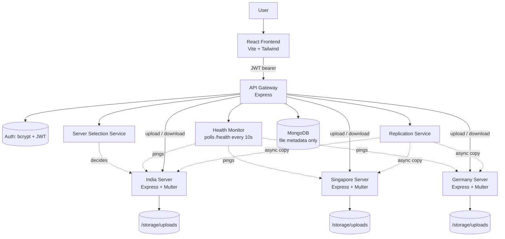

# GeoVault — GeoDistributed File Storage Platform

A MERN-stack system that uploads and downloads files through a single frontend, while an API Gateway transparently routes each request to the **nearest healthy regional server** — India, Singapore, or Germany — with automatic **replication** and **failover**.

Built as a portfolio-grade demonstration of API Gateway architecture, latency-based routing, distributed storage, and Docker-based multi-service deployment.

---

## 1. Project Overview

A user signs in once and uploads a file through a single React frontend. Behind the scenes:

1. The **API Gateway** authenticates the request and asks the **Server Selection Service** which regional node should hold the file (explicit region header, or the healthy region with the lowest measured latency).
2. The file is streamed to that **primary regional server**, which stores it on disk under a UUID filename.
3. Metadata (owner, size, primary region, replication state) is written to **MongoDB** — the file bytes themselves never touch the database.
4. Asynchronously, the Gateway replicates the file to a second healthy region so a single server outage can't cause data loss.
5. On download, the Gateway checks server health, prefers the primary, and **automatically falls back to the replica** if the primary is unreachable.

## 2. Architecture

```
User → React Frontend → API Gateway → Regional File Server → Local Storage
                              │
                              ├── Auth (JWT)
                              ├── Server Selection (latency / header)
                              ├── Health Monitor (polls every 10s)
                              └── Replication Service (async, backup region)
                              │
                         MongoDB (metadata only)
```

### Mermaid diagram



## 3. Tech Stack

| Layer | Technology |
|---|---|
| Frontend | React 18, Vite, Tailwind CSS, TanStack Query, React Router, react-dropzone, react-hot-toast |
| Gateway | Node.js, Express, JWT, bcryptjs, Multer, Zod, Helmet, express-rate-limit, Swagger/OpenAPI |
| Regional servers | Node.js, Express, Multer, UUID |
| Database | MongoDB (Mongoose) — metadata only |
| Logging | Winston (structured JSON logs, requestId correlation) |
| Deployment | Docker, Docker Compose, Nginx (frontend static serving) |

## 4. Features

- **Auth**: registration, login, bcrypt password hashing, JWT access tokens, protected routes.
- **API Gateway**: single entry point (`/api/*`), health checks, request forwarding, centralized rate limiting.
- **Server Selection**: `x-region` header for an explicit choice; otherwise picks the healthy region with the lowest measured latency.
- **Replication**: every upload is asynchronously copied to one backup region; MongoDB tracks `replicationStatus` and `replicatedServers`.
- **Failover**: downloads try the primary server first and automatically fall back to a healthy replica.
- **Security**: Helmet, CORS allow-list, rate limiting, Zod input validation, MIME/extension file-type filtering (executables rejected), 10 MB upload limit, JWT expiry, centralized error handler.
- **Frontend UX**: drag-and-drop upload with progress bar, live regional health panel, toast notifications, loading skeletons, error boundary.
- **Docs**: Swagger UI at `/api/docs` generated from JSDoc annotations on the route files.

## 5. Local Setup (without Docker)

Requires Node.js 20+, a local or Atlas MongoDB instance.

```bash
# 1. Gateway
cd gateway
cp .env.example .env   # edit MONGO_URI / JWT_SECRET as needed
npm install
npm run dev             # http://localhost:5000

# 2. Each regional server (repeat for india / singapore / germany)
cd services/india-server
cp .env.example .env
npm install
npm run dev              # http://localhost:5001

# 3. Frontend
cd frontend
cp .env.example .env
npm install
npm run dev               # http://localhost:5173
```

## 6. Docker Setup

The whole system — 6 services — starts with one command:

```bash
cp .env.example .env      # edit JWT_SECRET before any real deployment
docker compose up --build
```

| Service | Port |
|---|---|
| frontend | http://localhost:5173 |
| gateway | http://localhost:5000 |
| india-server | 5001 (internal) |
| singapore-server | 5002 (internal) |
| germany-server | 5003 (internal) |
| mongodb | 27017 |

Regional servers are not exposed publicly — only the Gateway talks to them, over the shared `geo-network` Docker network. Each has a named volume (`india-storage`, `singapore-storage`, `germany-storage`) so uploaded files survive container restarts.

## 7. Environment Variables

See `.env.example` at the repo root for Docker Compose, and `<service>/.env.example` in `gateway/` and each `services/*-server/` folder for standalone runs. Key variables:

| Variable | Where | Purpose |
|---|---|---|
| `JWT_SECRET` | gateway | Signs access tokens — **must** be changed for any real deployment |
| `MONGO_URI` | gateway | MongoDB connection string |
| `INDIA_SERVER_URL` / `SINGAPORE_SERVER_URL` / `GERMANY_SERVER_URL` | gateway | Base URLs the gateway proxies to |
| `MAX_FILE_SIZE_MB` | gateway | Upload size ceiling (default 10 MB) |
| `VITE_API_BASE_URL` | frontend | Gateway base URL, baked in at build time |

## 8. API Documentation

Interactive Swagger UI: **`http://localhost:5000/api/docs`** once the gateway is running. Covers `/api/auth/*`, `/api/files/*`, and `/api/gateway/health` with request/response schemas.

## 9. Screenshots

_Add screenshots of the Login, Dashboard, Upload, and My Files screens here before publishing to a portfolio or resume link._

## 10. Future Improvements

The following were scoped but intentionally left as documented next steps rather than shipped half-built:

- Redis caching for file metadata lookups
- WebSocket push notifications on upload/replication completion
- A retry queue (e.g. BullMQ) for failed replications instead of a single async attempt
- An admin dashboard surfacing server health history and storage-usage statistics over time
- Expiring public share links for files
- Background cleanup jobs for orphaned files after failed uploads
- Full TypeScript conversion of gateway and regional servers
- Unit tests (Vitest/Jest) and integration tests (Supertest) for the gateway's routing and failover logic
- Migrating from a single-backup replication model to configurable N-way replication

## 11. Deployment Notes

| Component | Suggested host | Notes |
|---|---|---|
| Frontend | Vercel | Set `VITE_API_BASE_URL` to the deployed gateway URL as a build-time env var |
| Gateway | Render / Railway | Set `MONGO_URI` to an Atlas connection string; set each `*_SERVER_URL` to the deployed regional server URLs |
| Regional servers | Render / Railway (one per region, ideally in that region's data center) | Attach a persistent disk for `/storage/uploads` |
| Database | MongoDB Atlas | Free tier is sufficient for a demo |

## 12. Resume Description

> **GeoVault — GeoDistributed File Storage Platform** — Designed and built a MERN-stack distributed file storage system with an API Gateway that routes uploads/downloads to the lowest-latency of three regional Node.js servers, replicates files asynchronously to a backup region, and automatically fails over reads when a server is unreachable. Implemented JWT auth, rate limiting, file-type validation, structured Winston logging, Swagger-documented REST APIs, and a 6-service Docker Compose deployment.

## 13. Interview Questions & Answers

**Q: Why store file metadata in MongoDB but the file bytes on disk on the regional servers?**
A: Storing large binary blobs in MongoDB (e.g. as GridFS or base64) bloats the database, slows backups, and doesn't scale well for a system meant to demonstrate geo-distribution. Keeping bytes on regional disks and only metadata centrally keeps the database small, fast, and lets each region scale its own storage independently.

**Q: How does the gateway decide which server is "nearest"?**
A: Two layers. Phase 1 is an explicit `x-region` header the client can send. Phase 2, used when no header is given or the requested region is unhealthy, is a periodic health-check loop that measures round-trip latency to each region's `/health` endpoint every 10 seconds and picks the lowest-latency **healthy** server. This is abstracted behind a single `selectBestServer(userRegion)` function so the routing policy can change without touching controllers.

**Q: What happens if the primary server goes down after a file was already uploaded there?**
A: The download controller doesn't hardcode the primary. It reads the file's `primaryServer` and `replicatedServers` from MongoDB, sorts them by current health status, and streams from the first healthy one — falling back to the replica transparently. The user never sees which server actually served the file.

**Q: Why is replication asynchronous instead of blocking the upload response?**
A: Blocking on a second network write would double the user-perceived upload latency and couple the primary upload's success to the replica's availability. Instead, the gateway responds as soon as the primary write succeeds, then replicates in the background and updates `replicationStatus` in MongoDB — trading a brief window of single-region risk for a much faster user-facing response.

**Q: How would this scale beyond three regions?**
A: The region list lives in one config module (`shared/config/regions.js`) consumed by both the health monitor and the selection service — adding a region means adding one entry and one new containerized service, no controller changes. At larger scale, the biggest structural change would be replacing the in-memory health registry with a shared store (e.g. Redis) so multiple gateway instances behind a load balancer see consistent health state.

**Q: What security measures protect the upload endpoint specifically?**
A: JWT-gated access, Multer file-size limits (10 MB), a blocked-extension list plus MIME-type allow-list that rejects executables, global rate limiting, and Helmet's default headers. Uploaded files are also given UUID-based stored names server-side, so the original filename (attacker-controlled) is never used as a path on disk — preventing path traversal.

**Q: Why keep the frontend as a single app rather than region-specific frontends?**
A: The routing complexity belongs at the gateway/API layer, not duplicated across frontends. A single React app talking to one gateway URL keeps the client simple and means the "nearest region" logic can evolve (e.g. from header-based to real geo-IP-based) without any frontend deployment changes.
